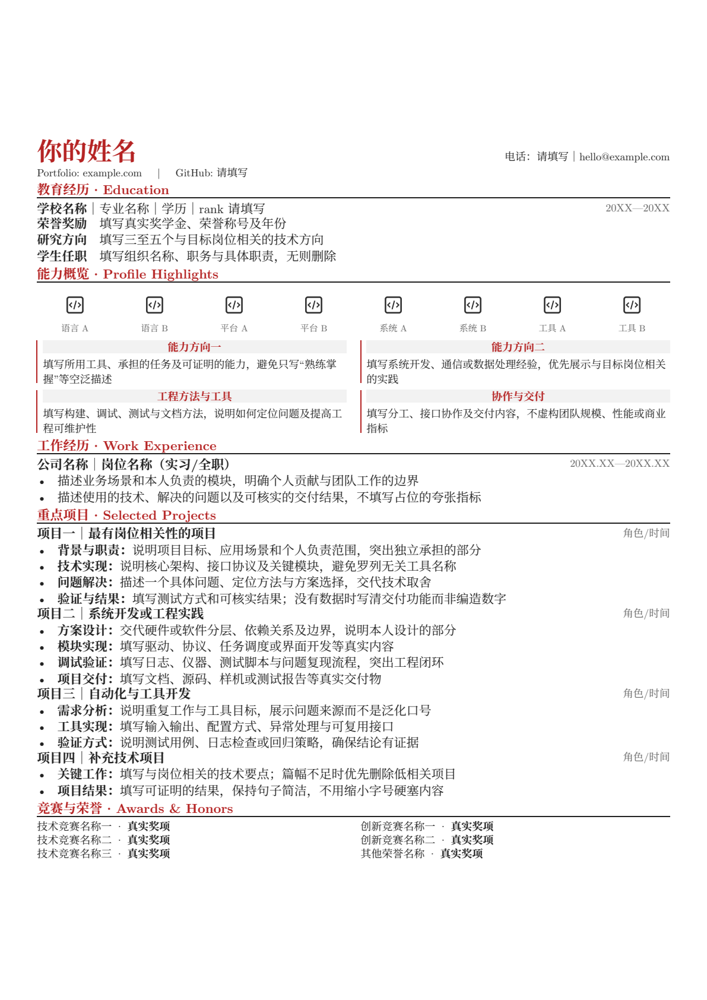

# Boweny CV

**一份注重信息密度与可读性的 A4 中文技术简历 Typst 模板。**

深红章节标题、深灰技术图标、双栏能力卡片与双栏荣誉列表。内容、组件、样式分离，适合嵌入式、软件开发及其他技术岗位自行填写。默认示例为虚构占位信息，不包含真实履历。

[查看示例 PDF](docs/cv.pdf) · [内容入口](main.typ) · [样式配置](theme.typ) · [参与贡献](CONTRIBUTING.md)

## 效果预览



## 设计特点

- **A4 单页示例**：正文 10.5pt，附加行距 6pt，左右边距 11mm，上下 10mm
- **清晰的信息层级**：中英文章节名、项目标题与右侧日期、重点加粗
- **灰度图标条**：支持 SVG / PNG，默认提供原创中性占位图，不携带品牌商标
- **模块化布局**：教育、能力、工作、项目与荣誉，按需增删
- **开箱可编译**：附带 Noto Serif SC 中文字体及许可证，无在线 Typst 包依赖
- **默认无照片**：需要时可加入照片，正文保持可选中、可检索

> 单页是示例效果，不是对任意内容长度的保证。优先精简低相关内容，避免靠缩小字号硬塞。

## 快速开始

### 本地编译

安装 [Typst](https://github.com/typst/typst/releases)（本模板使用 **0.15.1** 验证）：

```bash
git clone https://github.com/B0weny-qwq/boweny_cv.git
cd boweny_cv
# 此新版当前位于独立分支；合并后可省略下一行
git switch feat/public-typst-template
typst compile --font-path assets/fonts main.typ cv.pdf
```

也可运行 `./build.ps1`（PowerShell）或 `bash build.sh`（Bash），生成 `preview.pdf`。持续预览使用：

```bash
typst watch --font-path assets/fonts main.typ cv.pdf
```

`cv.typ` 保留为旧入口兼容文件，新编辑请从 `main.typ` 开始。

### Typst Web

下载仓库后，将整个项目上传至 [Typst Web](https://typst.app/)，把 `main.typ` 设为主文件。保留 `template.typ`、`theme.typ` 与 `assets/`，不要只上传一个文件。若字体未识别，请在项目字体面板确认已加载 `Noto Serif SC`。

## 填写自己的内容

编辑 `main.typ`：

```typst
#import "template.typ": resume, header, section, entry, tech, highlight, muted
#show: resume.with(name: "你的姓名")

#header([你的姓名],
  [电话：请填写｜邮箱：请填写],
  [个人主页 / GitHub：请填写],
)

#section[重点项目 · Selected Projects]
#entry([项目名称｜项目定位], right: [角色 / 时间])[
- *背景与职责：*说明应用场景及个人负责范围
- *技术实现：*说明关键方案和技术取舍
- *验证与结果：*填写可核实的测试方式或交付功能
]
```

示例中的学校、公司、时间和奖项均需替换；无相关经历的模块可删除。不要把模板中的引导语直接用于投递，也不要编造指标。

## 替换技术图标

1. 将图标放入 `assets/icons/`，推荐透明背景 SVG，PNG 建议至少 128px
2. 在 `main.typ` 的“图片位置1”下替换文件名与标签：

```typst
tech("python.svg", "Python")
```

3. 增减图标时同步修改 `grid(columns: (1fr,) * 8, ...)` 中的列数，建议 8—16 个

图标自动等比缩放；素材自带的过多留白需要先裁去。可从 [Simple Icons](https://simpleicons.org/)、[Nerd Fonts](https://www.nerdfonts.com/cheat-sheet) 或品牌官方媒体资源寻找图标，但需自行确认各自许可证与商标使用条件。本仓库不附带品牌 Logo，也不附带 Nerd Fonts 字体。

**灰色不是特殊下载版本**：对 SVG 修改 `fill` / `stroke` 为深灰即可，注意保留白色镂空；PNG 则在图像软件中灰度处理。Typst 的文字颜色不会自动重染图片。

## 配色与排版

统一修改 `theme.typ`：

| 配置 | 默认值 | 用途 |
| --- | --- | --- |
| `accent` | `#B52323` | 姓名、章节和卡片标题 |
| `ink` | `#222222` | 正文与分隔线 |
| `muted` | `#626262` | 日期与辅助标签 |
| `icon-color` | `#333333` | 素材配色参考，不会自动重染图片 |
| `card-bg` | `#F2F2F2` | 能力卡片标题背景 |
| `body-size` | `10.5pt` | 正文字号 |
| `leading` | `6pt` | 段内附加行距 |

```typst
#let accent = rgb("#174A70") // 深蓝；也可用 #245C48 墨绿
```

建议全篇只使用一种强调色，正文保持深色。章节字号、项目标题与卡片内部细节在 `template.typ` 中调整。页面上下使用等量弹性留白，内容较少时会垂直居中。

## 添加照片（可选）

默认不显示照片。将照片放进 `assets/private/`（已被 Git 忽略），取消 `main.typ` 中照片示例的注释并替换路径：

```typst
#align(right, image("assets/private/profile.jpg",
  width: 20mm, height: 27mm, fit: "cover"))
```

此示例位于页头之后，会增加高度，不是自动文字环绕。启用后请重新检查页数与留白。提交公开仓库前检查 Git 暂存区，确认没有私人照片或联系方式。

## 目录结构

```text
.
├── main.typ                 # 内容填写入口
├── template.typ             # 排版组件
├── theme.typ                # 配色、字号、行距、页边距
├── cv.typ                   # 旧入口兼容
├── assets/
│   ├── fonts/               # Noto Serif SC 与字体许可
│   ├── icons/               # 原创中性图标占位
│   └── images/              # 原创照片占位，默认不用
├── docs/
│   ├── cv.pdf               # 已编译的公开占位示例
│   └── preview.png          # 预览图
├── build.ps1 / build.sh     # 本地构建脚本
└── .github/workflows/       # GitHub Actions 编译检查
```

## 验证与发布

提交前重新编译，检查页数、字体、长链接、项目断行以及内容真实性。GitHub Actions 会使用附带字体编译新旧两个入口，并提供 PDF 构建产物；它不代替人工视觉检查。

公开发布时只保留占位示例；私人资料建议存放在独立的本地项目，避免写入公开 Git 历史。

## 许可

模板代码与原创占位图使用 [MIT License](LICENSE)。附带中文字体遵循其独立的 [SIL Open Font License](assets/fonts/LICENSE-NotoSerifSC.txt)，不受 MIT 覆盖；再次分发时请保留字体许可。自行添加的第三方图片和品牌商标需遵守相应权利人的条款。
